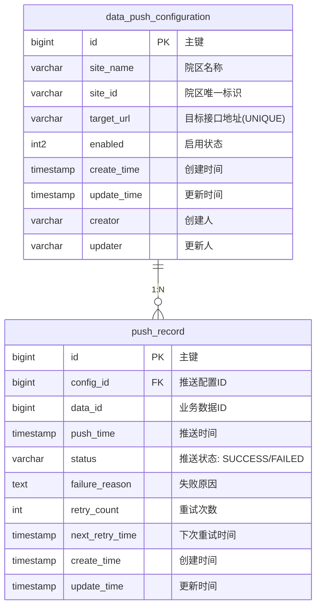

# 数据模型设计

**功能**：院区数据同步配置管理  
**分支**：sml-8241  
**创建时间**：2026年2月5日

## 实体关系图



**审计日志说明**：本功能使用项目统一的 `ICdpOpenApiService.addAuditLog()` 方法记录审计日志，不单独创建审计日志表。

## 主实体：data_push_configuration

### 表结构（DDL）

```sql
CREATE TABLE data_push_configuration
(
    id                bigserial PRIMARY KEY,
    site_name         varchar(200)           NOT NULL,
    site_id           varchar(200)           NOT NULL,
    target_url        varchar(500)           NOT NULL,
    enabled           int2                   NOT NULL DEFAULT 1,
    create_time       timestamp(0)           NOT NULL DEFAULT CURRENT_TIMESTAMP,
    update_time       timestamp(0)           NOT NULL DEFAULT CURRENT_TIMESTAMP,
    creator           varchar(255),
    updater           varchar(255),
    CONSTRAINT uk_target_url UNIQUE (target_url)
);

COMMENT ON TABLE data_push_configuration IS '院区数据推送配置表';
COMMENT ON COLUMN data_push_configuration.id IS '主键id';
COMMENT ON COLUMN data_push_configuration.site_name IS '院区名称';
COMMENT ON COLUMN data_push_configuration.site_id IS '院区唯一标识';
COMMENT ON COLUMN data_push_configuration.target_url IS '目标接口地址';
COMMENT ON COLUMN data_push_configuration.enabled IS '启用状态: 1=启用, 0=停用';
COMMENT ON COLUMN data_push_configuration.create_time IS '创建时间';
COMMENT ON COLUMN data_push_configuration.update_time IS '更新时间';
COMMENT ON COLUMN data_push_configuration.creator IS '创建人';
COMMENT ON COLUMN data_push_configuration.updater IS '更新人';

CREATE INDEX idx_data_push_configuration_enabled ON data_push_configuration (enabled);
CREATE INDEX idx_data_push_configuration_site_id ON data_push_configuration (site_id);
CREATE INDEX idx_data_push_configuration_create_time ON data_push_configuration (create_time);
```

### 字段说明

| 字段名 | 类型 | 约束 | 说明 |
|--------|------|------|------|
| id | bigserial | PK | 主键，自增 |
| site_name | varchar(200) | NOT NULL | 院区名称，用于界面显示 |
| site_id | varchar(200) | NOT NULL | 院区唯一标识，用于业务识别 |
| target_url | varchar(500) | NOT NULL, UNIQUE | 目标接口地址，全局唯一 |
| enabled | int2 | NOT NULL, DEFAULT 1 | 启用状态，1=启用，0=停用 |
| create_time | timestamp(0) | NOT NULL, DEFAULT CURRENT_TIMESTAMP | 创建时间 |
| update_time | timestamp(0) | NOT NULL, DEFAULT CURRENT_TIMESTAMP | 更新时间 |
| creator | varchar(255) | NULL | 创建人 |
| updater | varchar(255) | NULL | 更新人 |

### 业务规则验证

1. **唯一性约束**：
   - `target_url` 必须全局唯一（数据库约束）
   - 插入/更新前应用层也需验证，提供友好错误提示

2. **格式验证**：
   - `site_name`：非空、长度 1-200、非纯空格
   - `site_id`：非空、长度 1-200、非纯空格
   - `target_url`：非空、长度不超过 500

3. **状态转换规则**：
   - 启用 → 停用：允许
   - 停用 → 启用：允许
   - 删除操作：本需求不包含删除功能

### 关联关系

#### 与 push_record 的关系（1:N）
- 一个配置对应多条推送记录
- **关联字段**：`push_record.config_id` → `data_push_configuration.id`
- **查询场景**：获取配置的最新推送状态和时间
- **级联规则**：配置删除时（未来功能），需考虑 push_record 的处理

### 审计日志记录

本功能使用项目统一的审计日志服务，通过 `ICdpOpenApiService.addAuditLog()` 方法记录操作日志：

```java
void addAuditLog(AuditLogOperTypeEnum operationType, 
                 String operationContent, 
                 AuditLogStatusEnum status);
```

**记录时机**：
- 配置创建（CREATE）
- 配置更新（UPDATE）
- 配置启用（ENABLE）
- 配置停用（DISABLE）

**operationContent 格式示例**：
```json
{
    "siteName": "北京分院",
    "siteId": "BJ-001",
    "targetUrl": "https://center.example.com/api"
}
```

> 修改操作必须记录修改前后的值，例如：
```json
{
    "before": {
        "siteName": "北京分院",
        "siteId": "BJ-001",
        "targetUrl": "https://center.example.com/api"
    },
    "after": {
        "siteName": "北京分院",
        "siteId": "BJ-002",
        "targetUrl": "https://center.example.com/api/v2"
    }
}
```

## Java 实体类

### DataPushConfiguration.java

```java
package com.roche.smartqc.domain;

import java.util.Date;

/**
 * 院区数据推送配置实体
 */
public class DataPushConfiguration {
    
    /**
     * 主键
     */
    private Long id;
    /**
     * 院区名称
     */
    private String siteName;
    /**
     * 院区唯一标识
     */
    private String siteId;
    /**
     * 目标接口地址
     */
    private String targetUrl;
    /**
     * 启用状态: 1=启用, 0=停用
     */
    private Integer enabled;
    /**
     * 创建时间
     */
    private Date createTime;
    /**
     * 更新时间
     */
    private Date updateTime;
    /**
     * 创建人
     */
    private String creator;
    /**
     * 更新人
     */
    private String updater;
    
    // Getters and Setters
    public Long getId() {
        return id;
    }
    
    public void setId(Long id) {
        this.id = id;
    }
    
    public String getSiteName() {
        return siteName;
    }
    
    public void setSiteName(String siteName) {
        this.siteName = siteName;
    }
    
    public String getSiteId() {
        return siteId;
    }
    
    public void setSiteId(String siteId) {
        this.siteId = siteId;
    }
    
    public String getTargetUrl() {
        return targetUrl;
    }
    
    public void setTargetUrl(String targetUrl) {
        this.targetUrl = targetUrl;
    }
    
    public Integer getEnabled() {
        return enabled;
    }
    
    public void setEnabled(Integer enabled) {
        this.enabled = enabled;
    }
    
    public Date getCreateTime() {
        return createTime;
    }
    
    public void setCreateTime(Date createTime) {
        this.createTime = createTime;
    }
    
    public Date getUpdateTime() {
        return updateTime;
    }
    
    public void setUpdateTime(Date updateTime) {
        this.updateTime = updateTime;
    }
    
    public String getCreator() {
        return creator;
    }
    
    public void setCreator(String creator) {
        this.creator = creator;
    }
    
    public String getUpdater() {
        return updater;
    }
    
    public void setUpdater(String updater) {
        this.updater = updater;
    }
}
```

## 数据库迁移脚本（Flyway）

### V2.0.0.1__add_data_push_configuration.sql

```sql
-- 创建院区数据推送配置表
CREATE TABLE data_push_configuration
(
    id                bigserial PRIMARY KEY,
    site_name         varchar(200)           NOT NULL,
    site_id           varchar(200)           NOT NULL,
    target_url        varchar(500)           NOT NULL,
    enabled           int2                   NOT NULL DEFAULT 1,
    create_time       timestamp(0)           NOT NULL DEFAULT CURRENT_TIMESTAMP,
    update_time       timestamp(0)           NOT NULL DEFAULT CURRENT_TIMESTAMP,
    creator           varchar(255),
    updater           varchar(255),
    CONSTRAINT uk_target_url UNIQUE (target_url)
);

COMMENT ON TABLE data_push_configuration IS '院区数据推送配置表';
COMMENT ON COLUMN data_push_configuration.id IS '主键id';
COMMENT ON COLUMN data_push_configuration.site_name IS '院区名称';
COMMENT ON COLUMN data_push_configuration.site_id IS '院区唯一标识';
COMMENT ON COLUMN data_push_configuration.target_url IS '目标接口地址';
COMMENT ON COLUMN data_push_configuration.enabled IS '启用状态: 1=启用, 0=停用';
COMMENT ON COLUMN data_push_configuration.create_time IS '创建时间';
COMMENT ON COLUMN data_push_configuration.update_time IS '更新时间';
COMMENT ON COLUMN data_push_configuration.creator IS '创建人';
COMMENT ON COLUMN data_push_configuration.updater IS '更新人';

CREATE INDEX idx_data_push_configuration_enabled ON data_push_configuration (enabled);
CREATE INDEX idx_data_push_configuration_site_id ON data_push_configuration (site_id);
CREATE INDEX idx_data_push_configuration_create_time ON data_push_configuration (create_time);

-- 为 push_record 表添加索引（优化推送状态查询）
-- 注意：此索引在 push_record 表的迁移脚本中创建，这里仅作说明
-- CREATE INDEX idx_push_record_config_id_push_time ON push_record (config_id, push_time DESC);
```

## 数据字典

### 操作类型枚举（operation_type）

| 值 | 说明 | 触发场景 |
|----|------|---------|
| CREATE | 创建配置 | POST /api/v1/site-sync-configs |
| UPDATE | 更新配置 | PUT /api/v1/site-sync-configs/{id} |
| ENABLE | 启用配置 | PUT /api/v1/site-sync-configs/{id}/enable |
| DISABLE | 停用配置 | PUT /api/v1/site-sync-configs/{id}/disable |

### 推送状态枚举（currentPushStatus）

| 值 | 说明 | 计算逻辑 |
|----|------|---------|
| 已停用 | 配置已停用 | enabled = 0 |
| 实时推送中 | 推送成功状态 | enabled = 1 AND push_record.status = 'SUCCESS' |
| 推送异常（重试中） | 推送失败，正在重试 | enabled = 1 AND push_record.status = 'FAILED' |
| - | 无推送记录 | push_record 表中无相关记录（显示为空） |

## 性能优化建议

### 查询优化
1. **列表查询**：使用 LEFT JOIN LATERAL 子查询获取最新推送记录
2. **索引策略**：
    - `data_push_configuration`: enabled, site_id, create_time
   - `push_record`: (config_id, push_time DESC) 复合索引

### 缓存策略
1. **配置缓存**：频繁查询的配置可使用 Caffeine 本地缓存（TTL: 5分钟）
2. **推送状态缓存**：最新推送状态缓存（TTL: 1分钟）

### 分页策略
- 列表查询强制分页，默认每页 10 条，最大 100 条
- 使用 PageHelper 插件，避免内存溢出

## 安全考虑

### 数据安全
1. **SQL 注入防护**：所有查询使用 MyBatis 参数化查询
2. **唯一性约束**：防止重复配置
3. **外键约束**：保证审计日志数据完整性

### 审计要求
- 记录所有配置变更操作
- 审计日志不可修改、不可删除
- 保留完整的变更前后值

## 测试数据示例

### 示例配置 1
```json
{
  "id": 1,
  "siteName": "北京分院",
    "siteId": "BJ-001",
  "targetUrl": "https://center.example.com/api/beijing",
  "enabled": 1,
  "createTime": "2026-02-05T10:00:00Z",
  "updateTime": "2026-02-05T10:00:00Z",
  "creator": "admin",
  "updater": "admin"
}
```

### 示例配置 2（已停用）
```json
{
  "id": 2,
  "siteName": "上海分院",
    "siteId": "SH-001",
  "targetUrl": "https://center.example.com/api/shanghai",
  "enabled": 0,
  "createTime": "2026-02-04T09:00:00Z",
  "updateTime": "2026-02-05T11:00:00Z",
  "creator": "admin",
  "updater": "admin"
}
```
