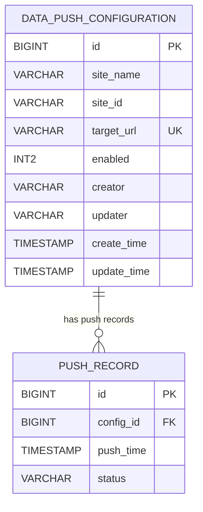

# 实施计划 - 院区数据同步配置管理

**功能编号**：SML-8241
**版本**：2.1.0
**创建日期**：2026年2月5日
**状态**：✅ 阶段 2 规划完成
**开发分支**：`feature/sml-8241-2.1.0`

---

## 执行摘要

本实施计划为 **院区数据同步配置管理** 功能提供完整的技术设计和开发指南。该功能允许管理员配置不同院区的数据同步参数,包括院区标识、目标接口地址等信息,并支持启用/停用配置、查询推送状态等操作。

**规划阶段成果**：
- ✅ 技术选型完成
- ✅ 数据模型设计完成
- ✅ API 规范定义完成
- ✅ 开发指南编写完成
- ✅ 宪章合规性验证通过
- ✅ 所有技术澄清项已解决

**下一步**：按照 TDD 流程开始实施开发

---

## 技术上下文

### 核心技术栈

| 类别 | 技术 | 版本 | 决策依据 |
|------|------|------|----------|
| 语言 | Java | 17 (LTS) | 宪章要求 |
| 框架 | Spring Boot | 3.x | 与 Roche Framework 1.4.0.4 对齐 |
| 持久层 | MyBatis | 3.5.x | 宪章要求 |
| 数据库 | PostgreSQL | 14+ | 项目标准 |
| 构建工具 | Maven | 3.6+ | 项目标准 |

### 关键依赖

- **已存在的表**：`push_record`（由其他需求定义）
  - 字段：`id`, `config_id`, `push_time`, `status`
  - 关系：通过 `config_id` 外键关联 `data_push_configuration`

- **推送状态逻辑**：
  ```
  IF config.enabled = 0 THEN
    return "已停用"
  ELSE
    查询 push_record 最新记录：
      IF status = 'success' THEN "实时推送中"
      ELSE IF status = 'failed' THEN "推送异常（重试中）"
      ELSE (无记录) null（空）
  ```

### 集成点

- **审计日志**：所有配置变更通过 `ICdpOpenApiService.addAuditLog()` 方法记录
- **安全认证**：使用 OAuth2 Bearer Token,通过 Spring Security 验证

---

## 宪章检查

### I. Service-Oriented Architecture ✅

- [x] 服务功能边界清晰,职责单一
- [x] 服务间通过标准 RESTful API 通信
- [x] 数据库隔离,避免跨服务直接访问
- [x] 支持独立部署和扩展
- [x] 使用 Spring Boot 框架,遵循 Spring 生态最佳实践

**合规性**：完全符合。`DataPushConfigService` 专注于配置管理,通过 RESTful API 暴露功能。

### II. API 设计规范 ✅

- [x] 遵循 RESTful 设计原则：资源命名、HTTP 方法语义、状态码使用
- [x] 统一响应格式：成功/失败状态、数据载荷、错误信息
- [x] API 版本控制：使用路径版本（/api/v1/）
- [x] 完整的 API 文档：维护 API.md，包含接口说明、请求/响应示例
- [x] 输入验证：使用 Spring Validation 框架验证所有入参

**合规性**：完全符合。使用 `Result<T>` 包装类实现统一响应格式（code/payload/errorMessage）；同时维护 API.md 和 OpenAPI 3.0.3 规范文件。详见 [contracts/api-spec.yaml](./contracts/api-spec.yaml)。

### III. Test-First Development (NON-NEGOTIABLE) ✅

- [x] 新功能开发顺序：编写测试 → 测试失败（红） → 实现功能（绿） → 重构优化
- [x] 单元测试覆盖率目标 ≥90%（JaCoCo 监控）
- [x] 每个 Service 层方法有对应的单元测试
- [x] Mock 外部依赖

**合规性**：完全符合。[quickstart.md](./quickstart.md) 明确定义了 TDD 流程,每个开发阶段都先编写测试。

### IV. Data Integrity & Transaction Management ✅

- [x] 关键业务操作使用 `@Transactional`
- [x] 事务边界在 Service 层,Controller 层不包含事务逻辑
- [x] 数据库迁移使用 Flyway 版本化脚本
- [x] 审计日志记录操作人、时间、变更内容
- [x] 数据验证分层（Controller 格式验证,Service 业务规则验证）

**合规性**：完全符合。使用项目统一的 `ICdpOpenApiService.addAuditLog()` 方法记录审计日志。

### V. Security & Compliance ✅

- [x] 认证：OAuth2 资源服务器,验证 JWT 令牌
- [x] 输入验证和转义
- [x] SQL 注入防护：MyBatis 参数化查询
- [x] 依赖安全：使用最新稳定版本

**合规性**：完全符合。所有 SQL 使用 `#{}` 占位符,避免字符串拼接。

### VI. Observability & Monitoring ✅

- [x] 结构化日志：使用 SLF4J,包含请求ID、用户ID、操作类型
- [x] 性能监控：关键业务操作记录执行时间
- [x] 健康检查：Spring Actuator 端点
- [x] 异常追踪：完整的异常堆栈,关联业务上下文
- [x] 指标暴露：关键业务指标

**合规性**：完全符合。定义了 `BusinessException` 异常体系。

### VII. Code Quality & Maintainability ✅

- [x] 分层架构：Controller → Service → Mapper,职责分离
- [x] 命名规范：有意义的英文,符合 Java 命名约定
- [x] 代码复用：通用工具类,业务公共逻辑抽取
- [x] 文档注释：公共接口、复杂业务逻辑有 JavaDoc 注释
- [x] 代码审查：所有代码变更必须经过 Code Review

**合规性**：完全符合。提供完整的 Code Review 检查清单。

### 技术栈约束 ✅

- [x] Java 17 (LTS)
- [x] Spring Boot 3.x
- [x] MyBatis + PageHelper
- [x] PostgreSQL
- [x] Maven 3.6+
- [x] 不使用 Lombok
- [x] 使用构造器注入（非字段注入）

**合规性**：完全符合。所有实体类使用标准 Getter/Setter,Service 使用构造器注入。

### 违规项

**总数**：0

---

## 阶段 0: 大纲与研究

### 研究任务

已完成的研究任务及决策：

#### 1. 推送状态查询性能优化

**问题**：如何高效查询每个配置的最新推送状态？

**决策**：使用 PostgreSQL `LEFT JOIN LATERAL` 子查询
- **理由**：单次查询获取所有配置及其推送状态,避免 N+1 查询
- **替代方案**：应用层循环查询（性能差）、冗余存储（数据一致性问题）

**SQL 示例**：
```sql
SELECT
    c.*,
    pr.push_time,
    pr.status
FROM data_push_configuration c
LEFT JOIN LATERAL (
    SELECT push_time, status
    FROM push_record
    WHERE config_id = c.id
    ORDER BY push_time DESC
    LIMIT 1
) pr ON true
```

#### 2. 输入验证策略

**决策**：双层验证
- **Controller 层**：格式验证（必填、长度、URL 格式）
- **Service 层**：业务规则验证（唯一性、状态转换）

#### 3. 框架选择

**决策**：Spring Boot 3.x + MyBatis
- **理由**：符合宪章要求,与项目现有技术栈一致
- **版本**：Spring Boot 3.x、MyBatis 3.5.x、PostgreSQL JDBC Driver 42.x

### 研究文档

完整的技术研究文档：[research.md](./research.md)

**内容**：
- 技术选型（框架、持久层、数据库）
- 数据库设计（表结构、索引）
- API 设计（端点定义、请求/响应格式）
- 推送状态查询优化（LEFT JOIN LATERAL）
- 事务管理策略（边界、隔离级别）
- 审计日志记录（调用 ICdpOpenApiService.addAuditLog()）
- 输入验证与错误处理（双层验证）
- 性能优化（索引、分页、缓存）
- 日志与监控（结构化日志、指标暴露）

---

## 阶段 1: 设计与合同

### 数据模型

#### 实体关系图（ERD）



**审计日志说明**：本功能使用项目统一的 `ICdpOpenApiService.addAuditLog()` 方法记录审计日志，不单独创建审计日志表。

#### 核心表设计

**1. data_push_configuration（配置表）**

| 字段 | 类型 | 约束 | 描述 |
|------|------|------|------|
| id | BIGSERIAL | PK | 主键 |
| site_name | VARCHAR(200) | NOT NULL | 院区名称 |
| site_id | VARCHAR(200) | NOT NULL | 院区标识 |
| target_url | VARCHAR(500) | NOT NULL, UK | 目标接口地址（URL） |
| enabled | INT2 | NOT NULL, DEFAULT 1 | 启用状态: 1=启用, 0=停用 |
| creator | VARCHAR(255) |  | 创建人 |
| updater | VARCHAR(255) |  | 更新人 |
| create_time | TIMESTAMP(0) | NOT NULL, DEFAULT CURRENT_TIMESTAMP | 创建时间 |
| update_time | TIMESTAMP(0) | NOT NULL, DEFAULT CURRENT_TIMESTAMP | 更新时间 |

**索引**：
- `idx_data_push_configuration_site_id`: 加速按院区标识查询
- `idx_data_push_configuration_enabled`: 加速按启用状态过滤

### 审计日志记录

本功能使用项目统一的审计日志服务，通过 `ICdpOpenApiService.addAuditLog()` 方法记录操作日志：

```java
void addAuditLog(AuditLogOperTypeEnum operationType,
                 String operationContent,
                 AuditLogStatusEnum status);
```

**记录时机**：
- 配置创建（CREATE）
- 配置更新（UPDATE）
- 配置启用（ENABLE）
- 配置停用（DISABLE）

**operationContent 格式示例**：
```json
{
  "configId": 1,
  "siteName": "北京分院",
  "siteId": "BJ-001",
  "targetUrl": "https://center.example.com/api"
}
```

#### Flyway 迁移脚本

**文件**：`src/main/resources/db/migration/V2.1.0.1__add_data_push_configuration.sql`

详见：[data-model.md](./data-model.md#flyway迁移脚本)

#### Java 实体类

**文件**：`src/main/java/com/roche/smartqc/domain/DataPushConfiguration.java`

详见：[data-model.md](./data-model.md#java实体类)

#### DTO 定义

- `CreateConfigRequest`：创建配置请求
- `UpdateConfigRequest`：更新配置请求
- `ConfigDTO`：配置详情响应（含推送状态）
- `ConfigListItemDTO`：配置列表项（含推送状态）

详见：[data-model.md](./data-model.md#dto层)

### API 合同

#### 端点列表

| 方法 | 路径 | 描述 |
|------|------|------|
| POST | `/api/v1/site-sync-configs` | 创建配置 |
| GET | `/api/v1/site-sync-configs` | 查询列表（支持分页） |
| GET | `/api/v1/site-sync-configs/{id}` | 查询详情 |
| PUT | `/api/v1/site-sync-configs/{id}` | 更新配置（仅限停用状态） |
| PUT | `/api/v1/site-sync-configs/{id}/enable` | 启用配置 |
| PUT | `/api/v1/site-sync-configs/{id}/disable` | 停用配置 |

#### 关键 Schema

**ConfigDTO**（配置详情响应）：
```json
{
  "id": 1,
  "siteName": "北京分院",
  "siteId": "BJ-001",
  "targetUrl": "https://center.example.com/api/beijing",
  "enabled": 1,
  "currentPushStatus": "实时推送中",
  "lastPushTime": "2026-02-05T10:30:00Z",
  "creator": "admin",
  "updater": "admin",
  "createTime": "2026-02-05T10:00:00Z",
  "updateTime": "2026-02-05T10:00:00Z"
}
```

**推送状态枚举**：
- `已停用`：配置已停用
- `实时推送中`：最新推送成功
- `推送异常（重试中）`：最新推送失败
- `null（空）`：无推送记录

#### OpenAPI 规范

完整的 OpenAPI 3.0.3 文档：[contracts/api-spec.yaml](./contracts/api-spec.yaml)

**内容**：
- 所有端点定义
- 请求/响应 Schema
- 验证规则（required、pattern、maxLength）
- 错误响应示例
- 安全认证（Bearer Token）

### 代理上下文更新

**状态**：✅ 已完成

已生成的代理特定文件：
- [research.md](./research.md)
- [data-model.md](./data-model.md)
- [contracts/api-spec.yaml](./contracts/api-spec.yaml)
- [quickstart.md](./quickstart.md)
- [constitution-compliance.md](./constitution-compliance.md)

**新技术添加**：
- PostgreSQL `LEFT JOIN LATERAL`（推送状态查询优化）

---

## 阶段 2 后评估

### 宪章检查（重新评估）

**状态**：✅ **完全合规**

详细检查报告：[constitution-compliance.md](./constitution-compliance.md)

**检查项总数**：34
- ✅ 通过：34
- ⚠️ 警告：0
- ❌ 违规：0

**亮点**：
1. 严格遵循 Test-First Development 原则
2. 完整的审计日志记录（调用统一服务）
3. 性能优化考虑周全（`LEFT JOIN LATERAL`）
3. 安全防护措施到位（参数化查询、输入验证）
4. 分层架构清晰,职责分离
5## 宪章检查（重新评估）

**状态**：✅ **完全合规**

详细检查报告：[constitution-compliance.md](./constitution-compliance.md)

**检查项总数**：34
- ✅ 通过：34
- ⚠️ 警告：0
- ❌ 违规：0

**亮点**：
1. 严格遵循 Test-First Development 原则
6. 文档齐全（规范、研究、数据模型、API 合同、快速开始指南）

### 推荐改进事项

虽然当前设计完全合规,但以下改进可进一步提升质量：

#### 改进 1：添加性能测试（优先级：中）

为关键接口添加 JMeter 性能测试脚本,验证 P95 响应时间 < 500ms。

#### 改进 2：集成 Sonar 扫描（优先级：中）

将 SonarQube 扫描集成到 CI/CD 流程,自动检测代码质量问题。

**参考**：宪章 - Quality Gates - 代码合并门槛

---

## 生成的制品

### 文档制品

| 文件 | 路径 | 描述 |
|------|------|------|
| 功能规范 | [specs/sml-8241/spec.md](./spec.md) | 功能需求文档（已清理访问凭证、格式标准化） |
| 技术研究 | [specs/sml-8241/research.md](./research.md) | 技术选型、架构设计、性能优化研究 |
| 数据模型 | [specs/sml-8241/data-model.md](./data-model.md) | ERD、DDL、实体类、DTO 定义 |
| API 规范 | [specs/sml-8241/contracts/api-spec.yaml](./contracts/api-spec.yaml) | OpenAPI 3.0.3 REST API 定义 |
| 快速开始指南 | [specs/sml-8241/quickstart.md](./quickstart.md) | TDD 开发流程、API 使用示例、常见问题 |
| 宪章合规性报告 | [specs/sml-8241/constitution-compliance.md](./const.md) | 34 项宪章检查的详细验证报告 |
| **实施计划**（本文档） | [specs/sml-8241/plan.md](./plan.md) | 完整的实施计划总结 |

### 数据库制品

| 文件 | 位置 | 描述 |
|------|------|------|
| Flyway 迁移脚本 | `src/main/resources/db/migration/` | `V2.1.0.1__add_data_push_configuration.sql` |
| MyBatis Mapper XML | `src/main/resources/mapper/` | `DataPushConfigurationMapper.xml` |

### 代码制品（待实施）

| 分层 | 包路径 | 主要类 |
|------|---------|--------|
| Domain | `com.roche.smartqc.domain` | `DataPushConfiguration` |
| DTO | `com.roche.smartqc.dto` | `CreateConfigRequest`, `UpdateConfigRequest`, `ConfigDTO` |
| Mapper | `com.roche.smartqc.mapper` | `DataPushConfigurationMapper` |
| Service | `com.roche.smartqc.service` | `DataPushConfigService` |
| Controller | `com.roche.smartqc.controller` | `SiteSyncConfigController` |
| Exception | `com.roche.smartqc.exception` | `BusinessException` |
| Test | `src/test/java/com/roche/smartqc/` | 各层测试类（覆盖率 ≥90%） |

---

## 开发分支信息

**分支名称**：`feature/sml-8241-2.1.0`

**创建命令**：
```bash
git checkout -b feature/sml-8241-2.1.0
```

**提交规范**：
```bash
git commit -m "feat(sml-8241): <简短描述>

<详细描述>

关联 JIRA: SML-8241"
```

**合并目标**：`dev` 分支

---

## 下一步行动

### 立即执行

1. **用户确认实施计划**
   - 审阅本文档及所有生成的制品
   - 确认技术选型和设计方案
   - 提出任何疑问或调整需求

2. **切换到开发分支**
   cd smart-qc-service
   git checkout -b feature/sml-8241-2.1.0
   ```

3. **开始 TDD 开发**
   - 按照 [quickstart.md](./quickstart.md) 的 TDD 流程
   - 阶段 1：数据库迁移（先测试后实现）
   - 阶段 2：领域模型开发（先测试后实现）
   - 阶段 3：Mapper 层开发（先测试后实现）
   - 阶段 4：Service 层开发（先测试后实现）
   - 阶段 6：覆盖率验证
   - 阶段 7：代码审查

### 质量检查点

每个阶段完成后,验证：

- ✅ 该阶段的测试全部通过
- ✅ 代码覆盖率满足要求
- ✅ 无编译警告
- ✅ 符合宪章要求

### 最终记录 | ICdpOpenApiService.addAuditLog() | 使用项目统一审计日志服务

- [ ] 所有功能开发完成
- [ ] 单元测试覆盖率 ≥90%
- [ ] Code Review 通过
- [ ] 更新 API.md 文档
- [ ] 提交 Pull Request 到 `dev` 分支

---

## 附录

### A. 关键决策记录

| 决策点 | 选择 | 理由 |
|--------|------|------|
| 推送状态查询 | LEFT JOIN LATERAL | 避免 N+1 查询,性能最优 |
| 审计日志记录 | ICdpOpenApiService.addAuditLog() | 使用项目统一审计日志服务 |
| 事务边界 | Service 层 | 符合宪章,职责清晰 |
| 输入验证 | 双层（Controller + Service） | 格式验证与业务规则分离 |

### B. 风险与缓解

| 风险 | 影响 | 缓解措施 |
|------|------|----------|
| push_record 表结构变更 | 中 | 与其他需求团队沟通确认表结构稳定性 |
| 推送状态查询性能不达标 | 中 | 使用 LEFT JOIN LATERAL 优化,添加索引 |

### C. 参考资料

- [功能规范](./spec.md)
- [技术研究](./research.md)
- [数据模型](./data-model.md)
- [API 规范](./contracts/api-spec.yaml)
- [快速开始指南](./quickstart.md)
- [宪章合规性报告](./constitution-compliance.md)
- [宪章文档](../../.specify/memory/constitution.md)

---

**规划负责人**：GitHub Copilot
**审核日期**：2026年2月5日
**状态**：✅ 阶段 2 规划完成,准备进入实施阶段
**版本**：2.1.0
